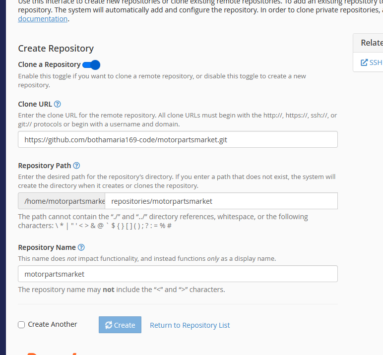

# Motor Parts Market — setup guide

Follow the sections in order. Each one ends with a test.

🟦 **ACCOUNT** = another website (GitHub, Groq, Google, Meta) · 🟩 **ADMIN** = your admin at `/admin` · 🟧 **CPANEL** = your hosting

## Every URL you'll paste

| Where | Field | Paste exactly |
|---|---|---|
| cPanel → Git™ Version Control | Clone URL | `https://github.com/bothamaria169-code/motorpartsmarket.git` |
| cPanel → Git™ Version Control | Repository Path | `repositories/motorpartsmarket` |
| cPanel → Git™ Version Control | Repository Name | `motorpartsmarket` |
| Meta → WhatsApp → Configuration | Callback URL | `https://motorpartsmarket.co.za/webhook.php` |
| Google Search Console | Sitemap | `sitemap.xml` |
| Your browser | Admin sign-in | `https://motorpartsmarket.co.za/login.php` |

---

## 1. Database (5 min) 🟧 CPANEL

> Make a **new, empty** database. Do not reuse the old site's database — its tables have the same names and the set-up will stop.

1. cPanel → **MySQL® Databases**.
2. **Create New Database** → type `mpm` → **Create Database**. Note the full name (it gets your account prefix, like `yourname_mpm`).
3. **MySQL Users → Add New User** → Username `mpm` → **Password Generator** → copy the password → **Create User**.
4. **Add User To Database** → pick the user and the database → **Add** → tick **ALL PRIVILEGES** → **Make Changes**.

**Test:** both appear under **Current Databases** with the user listed next to the database.

## 2. Secrets file (5 min) 🟧 CPANEL

1. On your computer, copy `config/secrets.example.php` and name the copy `secrets.php`.
2. Fill in `db_name`, `db_user`, `db_pass` from section 1.
3. Set `admin_seed_password` to a strong password. This is your first admin password.
4. Change `app_secret` and `cron_key` to long random text.
5. Do this **after section 3** has created the folders: cPanel → **File Manager** → `public_html/config` → **Upload** → choose your `secrets.php`.

> `secrets.php` is never in GitHub. Deploys do not touch it.

## 3. Put the site live (10 min) 🟦 ACCOUNT + 🟧 CPANEL

1. 🟦 Push the code to GitHub first (commands are in the README). The repository must not be empty when cPanel clones it.
2. 🟧 cPanel → **Git™ Version Control** → **Create**.
3. Leave **Clone a Repository** switched on.
4. **Clone URL**: `https://github.com/bothamaria169-code/motorpartsmarket.git`
5. **Repository Path**: `repositories/motorpartsmarket`
6. **Repository Name**: `motorpartsmarket`
7. Click **Create**.
8. In the list, click **Manage** → **Pull or Deploy** → **Update from Remote** → **Deploy HEAD Commit**.
9. Upload `secrets.php` (section 2, step 5).
10. cPanel → **Select PHP Version** → choose **8.2**.

> If the GitHub repository is private, cPanel cannot clone it with this address. Make it public, or use a GitHub token in the Clone URL.

> The old website's files stay in `public_html` next to the new ones. The new `index.php` replaces the old home page. Download a backup of `public_html` first if you want to keep the old site.

**Test:** open https://motorpartsmarket.co.za in a private window. You should see "Find the right car light. Just ask." and 12 products.

## 4. First sign-in and prices (15 min) 🟩 ADMIN

1. Open `https://motorpartsmarket.co.za/login.php`.
2. Email `admin@swiftfusion.co.za`, password = your `admin_seed_password`.
3. **Settings** → fill in **WhatsApp number** and **Enquiries go to this email** → **Save settings**.
4. **Products** → for each part type the **R price**, pick the status → **Save**.
5. Click **Edit** on each part → set **Condition**, **Side**, **Fits from year / to year** and **Known defects** → **Save part**.

> The year ranges were estimated from the photos. Check each one.

**Test:** open the site, tap a product. The price shows, and the green **WhatsApp** button opens a chat to your number.

## 5. Add new stock (2 min per part) 🟩 ADMIN

1. **Products** → **Add a part**.
2. Fill in **Title**, **Make**, **Model**, years, **Light type**, **Side**, **Condition**, **Price**.
3. **Other names customers type**: add nicknames and misspellings, e.g. `hilux, gd6, bakkie`.
4. **Add photos / videos** → choose the files from your phone or computer.
5. Optional: **✨ Write with AI** writes the description (needs section 6).
6. **Save part**.

**Test:** the new vehicle appears in the left list on the home page with its years, and typing its name in the chat finds it.

## 6. Groq AI (5 min) 🟦 ACCOUNT + 🟩 ADMIN

The chat works without AI. With it, the chat also understands messy messages.

1. 🟦 https://console.groq.com → sign in → **API Keys** → **Create API Key** → copy it.
2. 🟩 **Settings** → **Groq API key** → paste → **Save settings**.
3. Click **Test AI**.

**Test:** a green "Groq works" message appears.

## 7. Email (5 min) 🟧 CPANEL

1. cPanel → **Email Accounts** → **Create** → `info@motorpartsmarket.co.za`.
2. 🟩 **Settings** → **Enquiries go to this email** → that address → **Save settings**.
3. Click **Send test email**.

**Test:** the test email arrives (check spam). Every enquiry is also saved under **Enquiries**, even if email fails.

## 8. Daily clean-up job (3 min) 🟧 CPANEL

1. cPanel → **Cron Jobs** → **Common Settings**: **Once Per Day**.
2. **Command** (replace `CPANELUSER` with your cPanel username):
   `/usr/local/bin/php /home/CPANELUSER/public_html/cron.php >/dev/null 2>&1`
3. **Add New Cron Job**.

**Test:** open `https://motorpartsmarket.co.za/cron.php?key=YOUR_CRON_KEY`. It prints "Done" and the date.

## 9. Google (20 min) 🟦 ACCOUNT + 🟩 ADMIN

1. **Search Console** (search.google.com/search-console) → **Add property** → **URL prefix** → `https://motorpartsmarket.co.za` → **HTML tag** → copy only the code inside `content="…"`.
2. 🟩 **Settings** → **Search Console verification code** → paste → **Save settings** → back in Google click **Verify**.
3. Search Console → **Sitemaps** → type `sitemap.xml` → **Submit**.
4. **Analytics** (analytics.google.com) → **Admin** → **Create** → **Property** → add a **Web** stream → copy the **Measurement ID** (`G-…`).
5. 🟩 **Settings** → **Google Analytics 4 ID** → paste → **Save settings**.
6. **Google Business Profile** (business.google.com) → add the business with the same name, address and phone you use everywhere.

**Test:** Search Console shows "Ownership verified" and the sitemap status is "Success".

## 10. WhatsApp bot (30 min, optional) 🟦 ACCOUNT + 🟩 ADMIN

The green WhatsApp buttons already work with just your number (section 4). This section makes WhatsApp answer by itself with the same parts assistant.

1. 🟦 developers.facebook.com → **My Apps** → **Create App** → **Business** → add the **WhatsApp** product.
2. **WhatsApp → API Setup**: copy the **Phone number ID** and create a permanent **Access token**.
3. 🟩 **Settings → WhatsApp bot**: paste both, and make up a **Verify token** (any word) → **Save settings**.
4. 🟦 **WhatsApp → Configuration → Webhook → Edit**: Callback URL `https://motorpartsmarket.co.za/webhook.php`, Verify token = the same word → **Verify and save** → subscribe to **messages**.

**Test:** send "Hilux tail light" to the WhatsApp number. It replies with the Hilux taillights and a link.

> The bot only works on the live https site, not on localhost.
